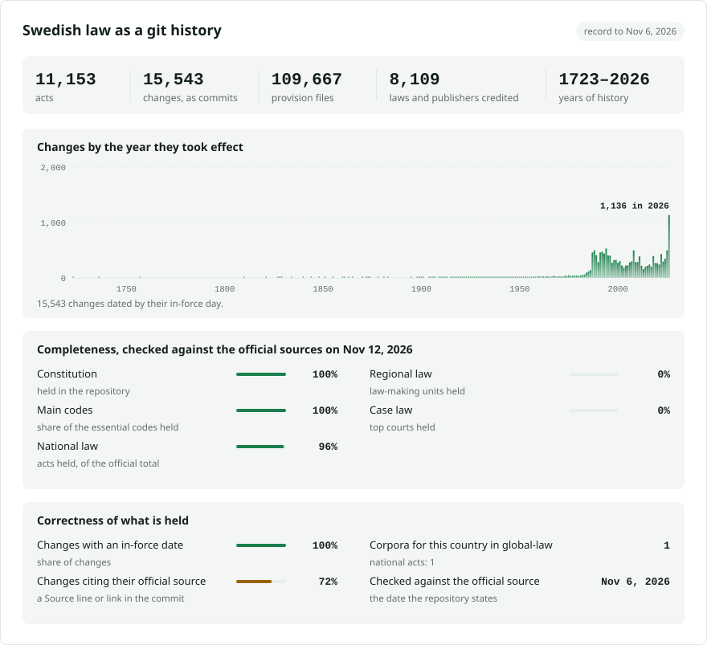

# Sweden: law history in git

**English** · **[Eller läs den på svenska](README.md)**

<picture>
<source media="(prefers-color-scheme: dark)" srcset="data/effort-dark.svg">

</picture>

The law of Sweden as a git history: one file per paragraf, one commit per version on the day it took effect. The sources keep only each statute's current consolidated text, so a statute's history starts with that text, credited to its publisher; the dated changes after it and its repeal are each credited to the act that made them. `git log` lists every change to a paragraf; `git blame` names who wrote each line; picking a date gives the text in force that day.

Part of [lexifina/global-law](https://github.com/lexifina/global-law), one git history for every country's law: this is Sweden's national law, which global-law reads at `sweden/national/acts/`.

**What is in it now:** 5,303 statutes of Svensk författningssamling (SFS) in force, among them the four fundamental laws; 5,813 repealed statutes, deleted on the day their repeal took effect and kept in the history; on the `future` branch, 37 statutes and 448 dated changes and repeals due after 28 October 2026; and the register of amendments (SFSR), 69,678 rows for 67,679 amending acts, in [`data/amendments.csv`](data/amendments.csv). [`laws.csv`](laws.csv) lists every statute, with its dates and status.

Each statute is in `<year>/<number>/`, by its SFS number, one file per paragraf, under `kap-<k>/` in statutes with chapters (`1962/700/kap-3/1.md` is 3 kap. 1 § of Brottsbalken, the Criminal Code, SFS 1962:700); the Instrument of Government (Regeringsformen) is [`1974/152/`](1974/152/).

The text is in Swedish, as the publisher prints it. An English translation is not part of this record.

## Questions as git commands

| Question | Command |
| --- | --- |
| Every change to Brottsbalken 7 kap. 4 §, including one already decided | `git log -p --word-diff origin/future -- 1962/700/kap-7/4.md` |
| Who wrote each line of 7 kap. 4 § from 1 January 2027? | `git blame origin/future -- 1962/700/kap-7/4.md` |
| Every version of Brottsbalken, with the day each takes effect | `git log --format="%h %(trailers:key=In-force,valueonly,separator=) %an" origin/future -- 1962/700` |
| 7 kap. 4 § as in force on 14 November 2026 | `python tools/in_force_on.py 2026-11-14 1962/700/kap-7/4.md` |

**Outside git**, we also host this record publicly, for free:

- **[Ask Claude about Swedish law](https://global-law.lexifina.com/v1/try_claude?country=sweden)**: opens Claude with a first question ready.
- **[Ask ChatGPT](https://global-law.lexifina.com/v1/try_chatgpt?country=sweden)**: the same question in ChatGPT.
- **[Search Swedish law on our site](https://lexifina.com/law?country=sweden&q=semester)**: a search for "semester", with each provision's text and its versions, no account needed.
- **[Developer REST API](https://global-law.lexifina.com/v1/search_law?query=semester&jurisdiction=sweden)**: the same search as JSON, with no key. See the [documentation here](https://lexifina.com/api/global-law).

Both assistants read the record through the free Global law connector (MCP, `https://global-law.lexifina.com/mcp`); the first time, the chat gives you the link that adds it. Ask in Swedish or in English.

**Host it yourself easily.** All it takes is git and Python, and the tools run on your machine:

```sh
git clone --depth 1 https://github.com/lexifina/global-law && cd global-law
python3 tools/countries.py add sweden/national/acts
python3 tools/law.py show 2026-11-14 sweden/national/acts/1962/700/kap-7/4.md
```

Opened in Claude Code, Cursor, VS Code or Codex, the clone also starts a local MCP server with the same tools ([MCP.md](https://github.com/lexifina/global-law/blob/main/MCP.md)).

## Dates

Each commit is dated at noon, Europe/Stockholm, on the day the version took effect, and carries it in its `In-force:` trailer:

- for a statute's consolidated text, the in-force day of the latest amending act it includes, from the SFSR register (the statute's own in-force day if nothing amended it; its issue day where the register gives none);
- for a provision the publisher prints in two dated versions ("/Upphör att gälla U:2027-01-01/", "/Träder i kraft I:2027-01-01/"), the printed day, and for a repeal, the day it took effect; provisions waiting for "den dag som regeringen bestämmer" are not applied ([`data/undated.csv`](data/undated.csv));
- git cannot store dates before 1970, so earlier commits are dated from 1970-01-01, seconds apart, with the real day in `In-force:`. Ask for a date with `tools/in_force_on.py`, not `git log --before`.

A consolidated text is credited to the publisher, `Regeringskansliet SFST (via Riksdagen open data)`, as many acts wrote it: its `Last-amended-by:` and `Amended-through:` trailers name the acts, and each paragraf ends with the act that last gave it its wording (`Lag (2026:1318).`). A statute the register shows unamended is credited to itself, a dated change to the act named in the new text, and a repeal to the repealing act.

## How it is checked

- `tools/build/check_repo.py` reads back every version of every statute on `main` and `future` and compares its letters and digits with the source: Riksdagen's plain-text field, which the build never reads, or for dated two-version provisions the HTML through a separate extractor. 0 mismatches in 11,541 versions.
- Every commit has an `In-force:` trailer that git can parse; there are no merges, no In-force dates going backwards and none after the build day on `main`.
- `tools/build/test_repo.py` checks blame, the dated tool before and after dated changes and a repeal, and authorship. The results, and a rebuild that gave the same hashes, are in [`REPRODUCE.md`](REPRODUCE.md).
- Each refresh appends to `main` only versions read back and compared with the source; published commits are never rewritten ([`REFRESH.md`](REFRESH.md)).
- [vulnerabilities/](vulnerabilities/README.en.md): possible drafting mistakes in this law, found by global-law's detectors and checked by hand. Not run yet.

## What it does not show

- **Earlier wording.** The sources keep only each statute's current consolidation, so no text before it is here; `data/amendments.csv` lists every amendment.
- **Amendments the consolidation does not yet include** (the publisher's text can lag the register), and changes since the last refresh.
- **Passages that cannot be dated.** 42 statutes that print two versions around chapters or headings are kept as printed, both versions (`Text: as-printed`).
- **Agency regulations (myndighetsföreskrifter), EU law and case law**, and the 133 nineteenth-century Riksdag regulations in the same open-data series (OCR text, not SFS).
- **Some statutes and all formatting.** Of the 11,437 SFS documents in Riksdagen's open data, 284 are not built: 260 that could not be read, 17 never in force and 7 waiting for a day not yet set (see `laws.csv` and [`data/unreadable.csv`](data/unreadable.csv)). Tables and italics are not kept.

## Sources

| Source | Kind | Past versions | Notes |
| --- | --- | --- | --- |
| [Riksdagens öppna data](https://data.riksdagen.se) | Consolidated statutes (SFST, Regeringskansliet) | no, the current consolidation only | Each statute's text, with its issue day, the last amendment included and its repeal; the authoritative text is the one in Svensk författningssamling |
| [SFSR, Regeringskansliets rättsdatabaser](https://rkrattsbaser.gov.se/sfsr) | Register of amendments | n/a | Every amending act, what it changed and its in-force day; it dates each text |
| [SFST, Regeringskansliets rättsdatabaser](https://rkrattsbaser.gov.se/sfst) | Consolidated statutes | no | The 6 old statutes Riksdagen's open data does not serve |

See [`SOURCES.md`](SOURCES.md) for what is read from each.

## Licence

See [`LICENSE`](LICENSE). Swedish statutes carry no copyright (upphovsrättslagen (1960:729) 1 kap. 9 §, [`1960/729/kap-1/9.md`](1960/729/kap-1/9.md)); the texts come from Riksdagens öppna data, free to use and redistribute with the source named (Källa: Sveriges riksdag), and this service is not provided or endorsed by Sveriges riksdag or Regeringskansliet. Lexifina's own contributions (the tools, the arrangement and the commit messages) are CC0 1.0.

No AI model wrote or changed legal text, and no model runs when the record is built; the scripts were written by an AI model (see [`REPRODUCE.md`](REPRODUCE.md)).

## Visualisations

- [visualisations/](visualisations/README.en.md): charts drawn from this repository. Not drawn yet.

## More

From [lexifina/global-law](https://github.com/lexifina/global-law):

- [FEATURES.md](https://github.com/lexifina/global-law/blob/main/FEATURES.md): every feature, and what every corpus must support (`git blame`, `law.py`, the MCP tools)
- [FAQ.md](https://github.com/lexifina/global-law/blob/main/FAQ.md): questions and answers · [CONTRIBUTING.md](https://github.com/lexifina/global-law/blob/main/CONTRIBUTING.md): proposing changes · [MCP.md](https://github.com/lexifina/global-law/blob/main/MCP.md): the MCP server · [REPRODUCE.md](https://github.com/lexifina/global-law/blob/main/REPRODUCE.md): how it was built · [CHANGELOG.md](https://github.com/lexifina/global-law/blob/main/CHANGELOG.md)
- [FRESHNESS.md](https://github.com/lexifina/global-law/blob/main/FRESHNESS.md): how current each corpus is · [Monitoring](https://github.com/lexifina/global-law/tree/main/monitoring): whether updates are running · [WATCHING.md](https://github.com/lexifina/global-law/blob/main/WATCHING.md): how each official source is watched for changes
- [performance/](https://github.com/lexifina/global-law/tree/main/performance): how fast the tools are, measured
- [visualisations/](https://github.com/lexifina/global-law/tree/main/visualisations): charts and bridges across the world's law
- [Vulnerabilities](https://github.com/lexifina/global-law/tree/main/vulnerabilities): mistakes in legislation as published
