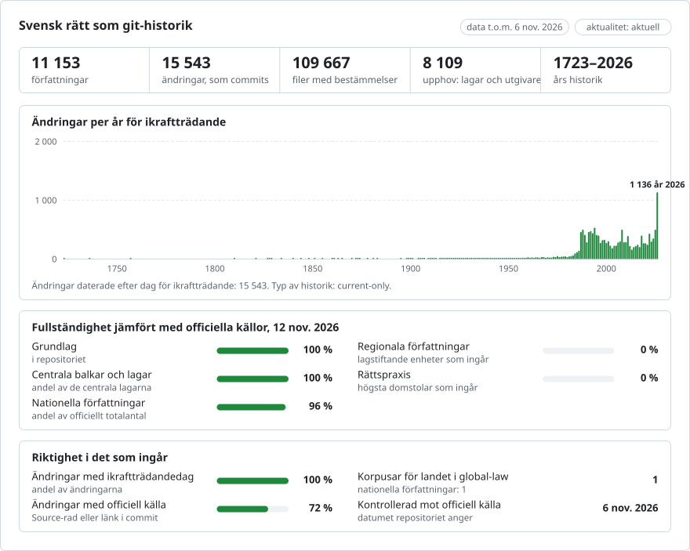

# Sverige: författningarnas historik i git

**Svenska** · **[Or read it in English](README.en.md)**

<picture>
<source media="(prefers-color-scheme: dark)" srcset="data/sv/effort-dark.svg">

</picture>

Sveriges författningar som en git-historik: en fil per paragraf, en commit per version på den dag den trädde i kraft. Källorna har bara varje författnings aktuella konsoliderade text, så en författnings historik börjar med den texten, som tillskrivs utgivaren; de daterade ändringarna därefter och upphävandet tillskrivs var och en den författning som gjorde dem. `git log` visar varje ändring i en paragraf; `git blame` anger vem som skrev varje rad; med ett valt datum får man den text som gällde den dagen.

En del av [lexifina/global-law](https://github.com/lexifina/global-law), en enda git-historik för alla länders rätt: detta är Sveriges nationella författningar, som global-law läser under `sweden/national/acts/`.

**Vad det innehåller nu:** 5 303 gällande författningar i Svensk författningssamling (SFS), bland dem de fyra grundlagarna; 5 813 upphävda författningar, raderade den dag upphävandet trädde i kraft och kvar i historiken; på grenen `future` 37 författningar och 448 daterade ändringar och upphävanden som träder i kraft efter den 28 oktober 2026; och ändringsregistret (SFSR), 69 678 rader för 67 679 ändringsförfattningar, i [`data/amendments.csv`](data/amendments.csv). [`laws.csv`](laws.csv) förtecknar alla författningar, med datum och status.

Varje författning finns i `<år>/<nummer>/`, efter sitt SFS-nummer, med en fil per paragraf, under `kap-<k>/` i författningar som är indelade i kapitel (`1962/700/kap-3/1.md` är 3 kap. 1 § brottsbalken, SFS 1962:700); regeringsformen finns i [`1974/152/`](1974/152/).

Texten är på svenska, så som utgivaren återger den. En engelsk översättning ingår inte i detta repositorium.

## Frågor som git-kommandon

| Fråga | Kommando |
| --- | --- |
| Varje ändring i 7 kap. 4 § brottsbalken, även en som redan är beslutad | `git log -p --word-diff origin/future -- 1962/700/kap-7/4.md` |
| Vem skrev varje rad i 7 kap. 4 § från den 1 januari 2027? | `git blame origin/future -- 1962/700/kap-7/4.md` |
| Varje version av brottsbalken, med den dag då den träder i kraft | `git log --format="%h %(trailers:key=In-force,valueonly,separator=) %an" origin/future -- 1962/700` |
| 7 kap. 4 § i den lydelse som gällde den 14 november 2026 | `python tools/in_force_on.py 2026-11-14 1962/700/kap-7/4.md` |

**Utanför git** tillhandahåller vi också detta material offentligt och gratis:

- **[Fråga Claude om svensk rätt](https://global-law.lexifina.com/v1/try_claude?country=sweden)**: öppnar Claude med en första fråga färdig.
- **[Fråga ChatGPT](https://global-law.lexifina.com/v1/try_chatgpt?country=sweden)**: samma fråga i ChatGPT.
- **[Sök i svensk rätt på vår webbplats](https://lexifina.com/law?country=sweden&q=semester)**: en sökning efter ”semester”, med varje bestämmelses text och dess versioner, utan konto.
- **[REST-API för utvecklare](https://global-law.lexifina.com/v1/search_law?query=semester&jurisdiction=sweden)**: samma sökning som JSON, utan nyckel. Dokumentationen finns [här](https://lexifina.com/api/global-law).

Båda assistenterna läser materialet genom den kostnadsfria kopplingen Global law (MCP, `https://global-law.lexifina.com/mcp`); första gången ger chatten dig länken som lägger till den. Fråga på svenska eller på engelska.

**Kör det enkelt själv.** Det enda som behövs är git och Python, och verktygen körs på din egen dator:

```sh
git clone --depth 1 https://github.com/lexifina/global-law && cd global-law
python3 tools/countries.py add sweden/national/acts
python3 tools/law.py show 2026-11-14 sweden/national/acts/1962/700/kap-7/4.md
```

Öppnad i Claude Code, Cursor, VS Code eller Codex startar klonen också en lokal MCP-server med samma verktyg ([MCP.md](https://github.com/lexifina/global-law/blob/main/MCP.md)).

## Datum

Varje commit dateras kl. 12.00 Stockholmstid (Europe/Stockholm) den dag versionen trädde i kraft, och dagen står i dess trailer `In-force:`:

- för en författnings konsoliderade text, ikraftträdandedagen för den senaste ändringsförfattning som texten omfattar, enligt SFSR-registret (författningens egen ikraftträdandedag om ingenting har ändrat den; utfärdandedagen där registret inte anger någon);
- för en bestämmelse som utgivaren återger i två daterade lydelser (”/Upphör att gälla U:2027-01-01/”, ”/Träder i kraft I:2027-01-01/”), den angivna dagen, och för ett upphävande, den dag det trädde i kraft; bestämmelser som väntar på ”den dag som regeringen bestämmer” tillämpas inte ([`data/undated.csv`](data/undated.csv));
- git kan inte lagra datum före 1970, så tidigare commits dateras från 1970-01-01 med några sekunders mellanrum, och den verkliga dagen står i `In-force:`. Fråga efter ett datum med `tools/in_force_on.py`, inte med `git log --before`.

En konsoliderad text tillskrivs utgivaren, `Regeringskansliet SFST (via Riksdagen open data)`, eftersom många författningar har skrivit den: dess trailrar `Last-amended-by:` och `Amended-through:` anger författningarna, och varje paragraf slutar med den författning som senast gav den dess lydelse (`Lag (2026:1318).`). En författning som enligt registret inte har ändrats tillskrivs sig själv, en daterad ändring den författning som anges i den nya texten och ett upphävande den upphävande författningen.

## Hur det kontrolleras

- `tools/build/check_repo.py` läser tillbaka varje version av varje författning på `main` och `future` och jämför dess bokstäver och siffror med källan: fältet med ren text hos Riksdagen, som bygget aldrig läser, eller för daterade bestämmelser i två lydelser HTML-texten genom en separat extraktor. 0 avvikelser i 11 541 versioner.
- Varje commit har en trailer `In-force:` som git kan tolka; det finns inga merges, inga In-force-datum som går bakåt och inga efter byggdagen på `main`.
- `tools/build/test_repo.py` kontrollerar blame, datumverktyget före och efter daterade ändringar och ett upphävande, samt upphovsuppgifterna. Resultaten, och ett nytt bygge som gav samma hashvärden, finns i [`REPRODUCE.md`](REPRODUCE.md).
- Varje uppdatering lägger bara till versioner på `main` som har lästs tillbaka och jämförts med källan; publicerade commits skrivs aldrig om ([`REFRESH.md`](REFRESH.md)).
- [vulnerabilities/](vulnerabilities/): möjliga redaktionella fel i denna rätt, hittade av global-laws detektorer och kontrollerade för hand. Inte körd ännu.

## Vad det inte visar

- **Tidigare lydelser.** Källorna har bara varje författnings aktuella konsolidering, så ingen text före den finns här; `data/amendments.csv` förtecknar varje ändring.
- **Ändringar som konsolideringen ännu inte omfattar** (utgivarens text kan ligga efter registret), och ändringar sedan den senaste uppdateringen.
- **Passager som inte kan dateras.** 42 författningar som återger två lydelser kring kapitel eller rubriker behålls som de är tryckta, med båda lydelserna (`Text: as-printed`).
- **Myndighetsföreskrifter, EU-rätt och rättspraxis**, och de 133 riksdagsförfattningarna från 1800-talet i samma serie av öppna data (OCR-text, inte SFS).
- **Vissa författningar och all formatering.** Av de 11 437 SFS-dokumenten i Riksdagens öppna data byggs 284 inte: 260 som inte kunde läsas, 17 som aldrig trätt i kraft och 7 som väntar på en dag som ännu inte är bestämd (se `laws.csv` och [`data/unreadable.csv`](data/unreadable.csv)). Tabeller och kursiv stil behålls inte.

## Källor

| Källa | Typ | Tidigare lydelser | Anmärkningar |
| --- | --- | --- | --- |
| [Riksdagens öppna data](https://data.riksdagen.se) | Konsoliderade författningar (SFST, Regeringskansliet) | nej, bara den aktuella konsolideringen | Varje författnings text, med utfärdandedag, senaste ändring som ingår och upphävande; den auktoritativa texten är den i Svensk författningssamling |
| [SFSR, Regeringskansliets rättsdatabaser](https://rkrattsbaser.gov.se/sfsr) | Ändringsregister | ej tillämpligt | Varje ändringsförfattning, vad den ändrade och dess ikraftträdandedag; daterar varje text |
| [SFST, Regeringskansliets rättsdatabaser](https://rkrattsbaser.gov.se/sfst) | Konsoliderade författningar | nej | De 6 äldre författningar som Riksdagens öppna data inte tillhandahåller |

Se [`SOURCES.md`](SOURCES.md) för vad som läses från varje källa.

## Licens

Se [`LICENSE`](LICENSE). Svenska författningar omfattas inte av upphovsrätt (1 kap. 9 § upphovsrättslagen (1960:729), [`1960/729/kap-1/9.md`](1960/729/kap-1/9.md)); texterna kommer från Riksdagens öppna data, som är fria att använda och sprida vidare så länge källan anges (Källa: Sveriges riksdag), och denna tjänst tillhandahålls inte av och är inte godkänd av Sveriges riksdag eller Regeringskansliet. Lexifinas egna bidrag (verktygen, strukturen och commit-meddelandena) omfattas av CC0 1.0.

Ingen AI-modell har skrivit eller ändrat författningstext, och ingen modell körs när materialet byggs; skripten skrevs av en AI-modell (se [`REPRODUCE.md`](REPRODUCE.md)).

Detta är en översättning av den engelska versionen ([README.en.md](README.en.md)); om de skiljer sig åt gäller den engelska versionen.

## Visualiseringar

- [visualisations/](visualisations/): diagram ritade ur detta repository. Inte ritade ännu.

## Mer

Från repositoriet [lexifina/global-law](https://github.com/lexifina/global-law) (på engelska):

- [FEATURES.md](https://github.com/lexifina/global-law/blob/main/FEATURES.md): alla funktioner och vad varje korpus måste stödja (`git blame`, `law.py`, MCP-verktyg)
- [FAQ.md](https://github.com/lexifina/global-law/blob/main/FAQ.md): frågor och svar · [CONTRIBUTING.md](https://github.com/lexifina/global-law/blob/main/CONTRIBUTING.md): föreslå ändringar · [MCP.md](https://github.com/lexifina/global-law/blob/main/MCP.md): MCP-server · [REPRODUCE.md](https://github.com/lexifina/global-law/blob/main/REPRODUCE.md): hur det är byggt · [CHANGELOG.md](https://github.com/lexifina/global-law/blob/main/CHANGELOG.md)
- [FRESHNESS.md](https://github.com/lexifina/global-law/blob/main/FRESHNESS.md): hur aktuellt varje korpus är · [Övervakning](https://github.com/lexifina/global-law/tree/main/monitoring): om uppdateringarna fungerar · [WATCHING.md](https://github.com/lexifina/global-law/blob/main/WATCHING.md): hur varje officiell källa bevakas för ändringar
- [performance/](https://github.com/lexifina/global-law/tree/main/performance): hur snabba verktygen är, uppmätt
- [visualisations/](https://github.com/lexifina/global-law/tree/main/visualisations): diagram och kopplingar över hela världens rätt
- [Sårbarheter](https://github.com/lexifina/global-law/tree/main/vulnerabilities): fel i författningar så som de publicerats
